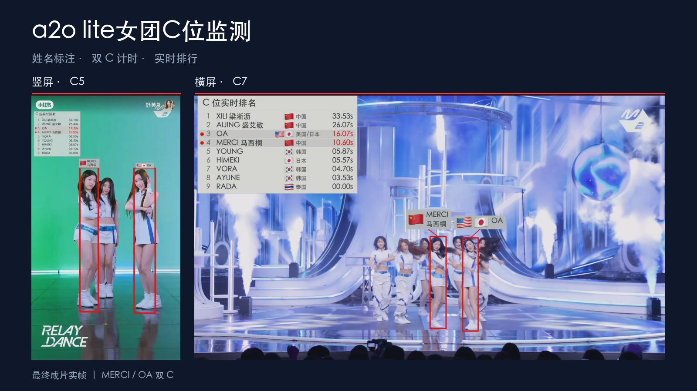

# a2o lite女团C位监测



封面截取两版最终成片 01:17 的双 C 画面：[竖屏截图](assets/covers/portrait.jpg) · [横屏截图](assets/covers/landscape.jpg)。

舞蹈视频 C 位候选检测、人工复核、姓名标注和逐帧计时。竖屏 C5 与横屏 C7 使用共享计时和导出入口，各自保留独立的时间线、坐标和最终复核数据。

当前自动检测基于 YOLO Pose、ByteTrack 和前排几何规则；姓名及主舞角色来自已有人工复核。三人主表演组合、主舞与陪衬关系仍需复核。

- [技术方案](docs/技术方案.md)
- [标注与配置格式](docs/数据格式.md)
- [迁移与历史版本](docs/迁移说明.md)
- [验证记录](docs/验证记录.md)

## 两版基线

| 项目 | 竖屏 portrait | 横屏 landscape |
| --- | --- | --- |
| 采用版本 | C5 最终版，含 AIJING 与 HIMEKI 修正 | C7 第八轮修订，含 2:16 AIJING 修正 |
| 标注帧数 | 6,824 | 6,657 |
| 固定帧率 | 30 FPS | 30 FPS |
| 标注坐标画布 | 720 × 1280 | 852 × 480 |
| 原生输出尺寸 | 720 × 1280 | 3456 × 1944 |
| 音乐起计帧 | 第 0 帧 | 第 60 帧，即第 2 秒 |
| 原片前置裁切 | 无 | 时间去掉 1.917375 秒，空间裁切见配置 |

每个可见 C 框每帧为对应成员累计 `1 / fps` 秒，双 C 分别计时，同分保持上一帧顺序。横屏的原片裁切偏移和成片音乐起点是两个独立参数。

## 安装

Python 3.9 或以上。仅校验和统计使用 Python 标准库；渲染需要 FFmpeg、FFprobe、OpenCV、NumPy、Pillow 和中文字体。

```sh
python3 -m venv .venv
source .venv/bin/activate
python -m pip install -e .
```

如需运行新视频的自动候选检测，再安装检测依赖：

```sh
python -m pip install -e '.[detect]'
```

FFmpeg 和 FFprobe 需在 PATH 中，也可使用 `--ffmpeg`、`--ffprobe` 指定位置。字体自动查找 macOS 黑体、Linux Noto CJK、Windows 微软雅黑；其他位置通过 `--font /path/to/font.ttc` 或 `C_MONITOR_FONT` 指定。

## 校验和统计

仓库已包含最终标注，无需视频或模型即可检查两版数据和输出统计。

```sh
python -m c_monitor validate --profile portrait
python -m c_monitor validate --profile landscape
python -m c_monitor report --profile portrait --output-dir outputs/portrait-report
python -m c_monitor report --profile landscape --output-dir outputs/landscape-report
```

报告包含 `summary.json`、`member_times.csv`、`timing_intervals.json` 和 `ranking_frames.jsonl`。输出目录须为空或不存在。安装后也可使用 `c-monitor` 命令。

## 导出竖屏

使用原始、未画框的 `c5.mp4`，尺寸为 720 × 1280。

```sh
python -m c_monitor render --profile portrait \
  --video /path/to/c5.mp4 --output-dir outputs/portrait-final
```

## 导出横屏

使用原始全屏录屏，原始尺寸为 3456 × 2234。配置会从原片去掉 1.917375 秒，再裁切 `[0, 178, 3456, 1944]`。输入已经裁切或画框的成片会产生重复处理，应使用原始素材。

```sh
python -m c_monitor render --profile landscape \
  --video /path/to/original-screen-recording.mp4 \
  --output-dir outputs/landscape-final
```

默认按原生尺寸输出 H.264 视频和 AAC 音频。`--height 720` 可输出等比例检查版本。渲染采用 FFmpeg 时间戳解码及 30 FPS 归一化，支持原录屏的可变帧率。

只检查最新修订附近的两秒画面：

```sh
python -m c_monitor render --profile landscape \
  --video /path/to/original-screen-recording.mp4 \
  --start-frame 4068 --max-frames 60 --height 720 \
  --output-dir outputs/landscape-review
```

短片中的排行榜先累计第 0 帧到起始帧之前的标注，再逐帧更新。随片导出的报告覆盖完整标注时间线，短片范围另记在 `summary.json` 的 `render` 字段中。每次导出另存首尾核对图。

## 新视频候选检测

```sh
python -m c_detect /path/to/new-video.mp4 \
  --output-dir outputs/new-detection --mode frontrow \
  --model yolo11s-pose.pt --imgsz 960 --device cpu
```

Apple Silicon 可设置 `--device mps`。模型文件由用户准备或由 Ultralytics 按模型名获取。自动检测输出跟踪编号、候选框和诊断视频；编号不能直接作为成员姓名，诊断视频不带原声。复核确定成员与可见红框后，再按 [数据格式](docs/数据格式.md) 建立新 profile，进入共享计时与导出流程。旧 `formation`、`relay` 模式保留兼容，以 `frontrow` 为当前候选基线。

## 目录

```text
c_detect/                 原候选检测、前排判断、窄框与防抖算法
c_monitor/                共享校验、计时、报告和视频导出
  data/profiles/          竖屏与横屏配置
  data/reviewed/          两版最终逐帧复核标注
  data/flags/             姓名牌与排行榜所用旗帜图标
docs/                     技术方案、数据协议和迁移记录
legacy/                   历史脚本和修正规则，供追溯
tests/                    算法回归、计时规则和最终数据校验
```

统一导出使用共享姓名牌与排行榜布局；最终标注中的成员和框坐标保持原值，计时重新由这些可见框计算。视频、模型权重、运行输出及其他项目数据由 `.gitignore` 排除。

```sh
python -m unittest discover -s tests -v
```
