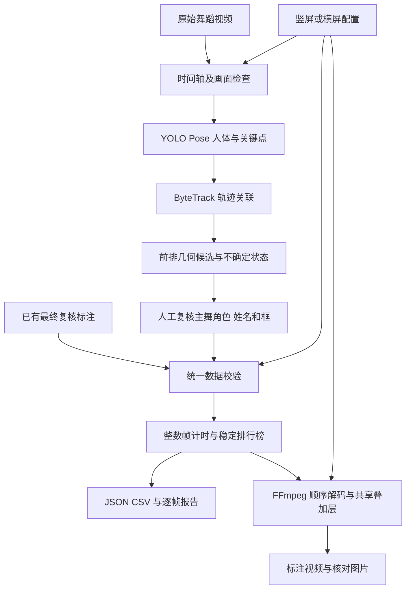

# 竖屏与横屏 C 位监测技术方案

本方案用于固定机位舞蹈视频的 C 位标注、成员计时和可核对的视频输出。系统采用人体姿态检测生成候选，通过人工复核确认主表演角色和姓名，再以最终可见红框为唯一计时依据。竖屏和横屏共用数据校验、计时、排行榜及导出模块，通过配置区分时间线和坐标。

## 业务规则

C 位指当前主表演位置，单帧最多两人。两人主表演组合为双 C，分别计时；三人主表演组合只选中间一人。此处组合指主表演成员，不是画面内全部可见人数。

仍在主舞中的转身、跳跃和俯身保留角色；退出主舞、静止陪衬或辅助动作不计。左右两人在前、中央一人在后时，应排除中央后排。完全遮挡与角色交接按对应视频的复核结果处理。仅 C 位绘制红框和姓名，其他成员不进入姓名计时。

音乐开始才画框计时。竖屏从第 0 帧起计时；当前横屏前 60 帧作为音乐前准备画面，保持空框和零累计。修改规则后应更新逐帧标注，再从第 0 帧重算全部统计。

## 系统架构

`c_detect` 保留已有自动候选算法。`c_monitor.dataset` 检查配置和复核标注，`c_monitor.timing` 负责整数帧计数与报告，`c_monitor.drawing` 绘制姓名牌和排行榜，`c_monitor.media` 调用 FFmpeg 完成解码与编码。默认校验与报告不依赖视频、GPU 或检测模型。

## 自动候选检测

YOLO Pose 提供人体框与 COCO 关键点，ByteTrack 关联相邻帧中的可见人物。可靠脚踝中更靠下的点作为脚部观测，最近 0.6 秒观测的高分位数用于降低抬腿和跳跃造成的前后排抖动。

固定机位、平坦舞台条件下，脚落点在图像中越靠下，作为越靠前的线索。前排容差取可见身高中位数的 7.5%，并限制为图像高度的 1.8% 到 5%。完整人体缺少脚点时可用框底估计；明显截断的人体与框外异常脚点应排除。候选集合持续稳定 0.25 秒后确认。

前排一人生成单 C 候选，两人生成双 C 候选，三人及以上无法区分时输出不确定。默认前排算法不通过横向居中程度打破平局。它尚未自动理解三人主表演组合及主舞与陪衬语义，业务规则的最终实现依赖复核标注。

候选状态包括 `selected`、`stabilizing`、`ambiguous_front_row`、`depth_unavailable` 和 `insufficient_people`。正式编号结果使用 `selected_ids` 数组；兼容字段 `selected_id` 在双 C 时为 `null`。跟踪编号只表示局部轨迹，遮挡后可能改变，不能直接汇总为成员身份。

## 复核与成员对应

复核结果按帧保存 `members` 和 `boxes`，两者一一对应。姓名由已确认成员顺序、服装、站位及连续身体运动共同确定，不通过人脸或跟踪编号自动推断身份。中国成员的中文名集中配置，AIJING 使用“盛艾敬”。

竖屏最终基线采用 `c5-red-name-aijing-himeki`，包含 1:57 AIJING 与 2:00 HIMEKI 的更正。横屏最终基线采用 `neon-screen-recording-v8`，保留前七轮修正，并将 `[4071, 4085)` 的 14 帧由 XILI 改为 AIJING，同时调整 `[4071, 4115)` 的连续身体框。

历史角色修正规则与脚本保存在 `legacy/`。新运行直接读取最终标注，避免重放多个历史补丁时遗漏前置文件。两个标注文件均保留原始内容及 SHA256；默认执行时校验文件哈希和各成员累计帧数，便于确认使用了正确版本。

## 竖屏与横屏适配

| 参数 | 竖屏 | 横屏 |
| --- | --- | --- |
| 最终标注帧数 | 6,824 | 6,657 |
| 采样帧率 | 30 FPS | 30 FPS |
| 标注坐标画布 | 720 × 1280 | 852 × 480 |
| 原始素材尺寸 | 720 × 1280 | 3456 × 2234 |
| 输出画面尺寸 | 720 × 1280 | 3456 × 1944 |
| 原片时间裁切 | 0 秒 | 1.917375 秒 |
| 原片空间裁切 | 无 | x 0，y 178，宽 3456，高 1944 |
| 音乐起计帧 | 0 | 60 |

标注框按照标注画布和输出尺寸分别缩放横纵坐标。横屏 `852 × 480` 是历史标注坐标系，保留该坐标系以延续已有修订。导出可选择较低输出高度进行核对，正式输出默认采用原生尺寸。

两份视频有各自的帧数和起止画面，不直接要求成员累计时间相等。原历史横屏制作通过音乐对齐迁移角色顺序，再结合本场身体位置复核；最终帧文件已吸收这些映射，新导出不得再次应用旧的跨视频偏移。

## 时间轴与音画处理

横屏原录屏采用可变帧率，按 OpenCV 毫秒随机跳转会出现定位偏差。统一导出采用 FFmpeg 按时间戳解码，在裁切后的时间线上通过 `fps=30` 生成连续输出帧，再使用 `[start_frame, end_frame)` 选择导出范围。

原始时间与当前横屏输出时间的对应为：`source_seconds = 1.917375 + frame / 30`。音乐起点另为输出第 60 帧，对应输出 2 秒；这段准备画面仍保留原音画，只清空 C 框与计时。

渲染前检查素材是否含视频、尺寸是否匹配或足以容纳裁切区域、时长是否覆盖请求范围。视频按照 H.264 编码；存在音轨时，从同一原片以对应时间裁切并编码为 AAC。无音轨素材仍可输出静音视频。短片核对时，排行榜预先累计起始帧之前的全部标注，保持与完整视频一致。

## 计时与排行榜

内部使用整数帧累计，显示或导出时才除以帧率。对于成员 m：

`frames[m] = Σ I(m 出现在当前帧的可见 C 框中)`

`seconds[m] = frames[m] / fps`

双 C 一帧同时为两位成员各加一帧。因此所有成员时长之和是人秒，可以超过视频时长。空框帧保持所有成员计数不变；不得按候选角色持续时间补算未显示的框。

每帧按累计帧数降序稳定排序。同分沿用上一帧顺序，只有超过上一名后才换位。区间采用左闭右开 `[start_frame, end_frame_exclusive)`，成员集合相同但左右顺序交换时，不额外切割计时区间。

最终竖屏总计 299.1 人秒，横屏总计 294.8 人秒。这些数值用于校验基线，反映已复核标注的统计结果，不作为识别准确率指标。

## 数据校验与输出

执行前检查帧号从 0 连续递增、总帧数匹配、每帧 0 至 2 个框、框与姓名数量一致、姓名来自成员表且不重复、坐标有限且在画布内、可选时间字段与帧号一致，以及音乐前区间为空。默认还检查 SHA256、成员累计帧数和单 C 双 C 空框帧数。

有意修改标注时可通过 `--no-baseline` 关闭历史哈希和累计数值比对，所有结构与时间约束继续生效。更改视频长度或音乐起点时应另存新的配置，重新确认预期值并保留修订记录。

| 输出 | 内容 |
| --- | --- |
| `annotated.mp4` | 共享布局的红框、国旗姓名与动态排名 |
| `preview-*.jpg` | 本次导出首尾帧的核对图 |
| `summary.json` | 基线、帧数、累计时间、排序和导出范围 |
| `member_times.csv` | 成员排名、中文名、帧数和秒数 |
| `timing_intervals.json` | 按成员集合合并的连续区间 |
| `ranking_frames.jsonl` | 全时间线逐帧活动成员、排序和累计帧数 |
| `render.log` | FFmpeg 解码和编码诊断 |

输出目录须为空或不存在。视频先写入 `annotated.partial.mp4`，编码成功后才改名为 `annotated.mp4`。处理失败保留日志和中间文件用于排查，避免将未完成结果当作成品。

## 验收与回归

自动回归覆盖前排单双 C、中央后排排除、三人齐平不确定、抬腿、人物消失、框防抖、角色切换、双人计时、空框停表及同分稳定排序。两版全部 13,481 帧均检查数据约束和最终累计值；特定断言检查横屏第 2294 至 2310 帧的 MERCI 与 OA 双 C、音乐前 60 帧及第 4071 至 4084 帧的 AIJING 修正。

视频验收分为原片短片导出、首尾图人工检查、顺序解码计帧及音轨时长核对。具体已执行项和范围见 [验证记录](验证记录.md)。完整视频重新交付时，还需核对角色交接、遮挡、双框靠近和片尾等关键画面；通过数据测试不等于已建立通用识别准确率。

## 部署与后续迭代

当前以本地命令行运行，支持 CPU 导出；自动检测可以使用 CPU 或可用的 MPS 等设备。配置和复核文件随 Python 包分发，视频、模型权重和运行输出保存在仓库外或忽略目录中。GitHub Actions 在代码变更时运行回归测试与两版基线校验。

下一阶段可建立带主舞角色、交接边界和遮挡状态的独立测试集，分别测量候选召回率、身份连续性、交接时间误差与成员累计时间误差。在评估数据充分后，再加入动作语义判断和成员持续关联。之后可开发复核界面，支持拖动时间线、编辑框、确认交接并自动生成带版本号的配置和修订记录。
